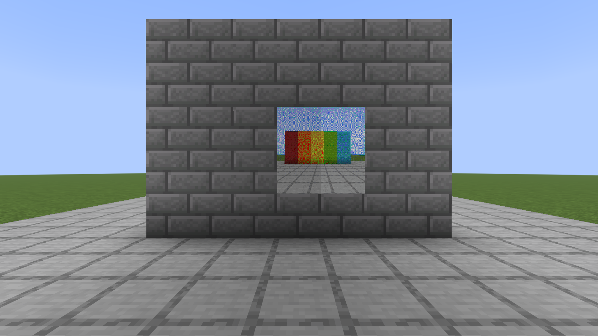

# Redstone Photography

A server-side Fabric mod for taking photographs: craft a camera and film, take a picture of exactly what you see or set the camera down and let redstone take it, develop the film in a cauldron in a darkroom lit only by redstone, and hang the print on a wall.

## Taking a picture

1. **Craft a camera** from obsidian, copper, an amethyst lens, a button and redstone, and **film** from paper and ink. The recipes are below.
2. **Load it.** In your inventory, click film onto the camera, as you would put things in a bundle: a left click loads all the film that fits, a right click loads one. A camera holds **16 film**, and exposed film takes up space in it until you take it out.
3. **Right-click with the camera.** It takes a picture of what is on your screen, without your hotbar, hand or crosshair, as a square from the middle of the view. Each picture exposes one film in the camera. A creative player needs no film.
4. **Take the exposed film out.** Right-click the camera in your inventory with nothing held, and the last exposure comes out as an **Exposed Film** marked with who took it.

The camera won't take a picture while a screen is open over the world; close it and try again. In the creative inventory, clicking film onto the camera doesn't load it; load a placed camera instead.

## A camera set down

**Sneak and right-click a block** with the camera to set it down there, its lens facing the way you are looking. Its film comes with it.

- **Right-click it with film** to load it, as many as fit.
- **Right-click it with an empty hand** to take out all its exposed film. It also tells you how much film it holds.
- **Power it with redstone** and it takes a picture through its lens, onto one of its film. It shoots once each time the signal comes on. With no film it clicks and takes nothing.
- **Break it** and it drops as a camera, with its film still inside.

A placed camera's picture is drawn by a player's game, since the server can't draw the world itself. The nearest player who has the camera's area loaded draws it, out of sight, so they see nothing of it. If nobody is close enough, the camera clicks and takes nothing, and no film is used. That player needs Pandorical 15.22 or later. A picture from a placed camera is marked as taken by whoever set the camera down, and shows the world as that game draws it, so it includes any player standing in front of the lens.

## Developing

Exposed film is developed in a **water cauldron** in a **darkroom**:

- **No daylight.** The room has to be closed: no sky light may reach the cauldron, through a window, an open door or a gap in the roof.
- **Only redstone light.** The room has to be lit, and every light that reaches the cauldron has to be redstone light: a lit redstone lamp, a redstone torch, or glowing redstone ore. A torch, a lantern, glowstone, lava or anything else that shines into the room spoils it. Light behind a solid wall doesn't count; light round the corner of an open doorway does.

Right-click the cauldron with the exposed film. If the room isn't a darkroom you are told why and keep the film. If it is, the film floats on the water and develops for **ten seconds**. Keep other light out while it does: if daylight or any light but redstone reaches the cauldron before it is done, the film is fogged and lost. The redstone light going off does no harm.

When it is done the photograph pops out of the cauldron, and the water drops a level. Right-click the cauldron with an empty hand while it develops to take the film back out, undeveloped.

## Hanging

Right-click a wall with a photograph. A photograph is two blocks by two, centred on the block you click, and needs a flat wall its full size with open space in front. Hit any part of it to take the whole thing down; as with vanilla paintings, a creative player gets nothing back. If the wall behind it goes, the photograph comes down.

Photographs are drawn on maps, so a print is the picture in the colours a map can show, dithered to keep the shading.

## On the server

Every picture taken is kept as a PNG, 512 pixels square, in the world folder under `redstone-photography/`, named by the picture's id. A film carries only that id until it is developed, so a picture can't be developed once its file has gone.

The picture comes from a player's own client, the photographer's or, for a placed camera, the nearest player's. A modified client can send any picture it likes as a photograph.

The safelights are the block tag `redstone-photography:safelights`: redstone lamps, redstone torches and redstone ore. A datapack can add to it.

## Recipes

- **Camera**: obsidian, a stone button and a copper ingot along the top; redstone, an amethyst shard and obsidian below.
- **Film** (4): two paper and an ink sac.

## Pandorical

Redstone Photography runs server-side, and Pandorical is required: the server will not load this mod without it. Pandorical syncs the items to connecting clients, and its client takes the pictures.

Clients need Pandorical 15.15 or later to take pictures, and 15.22 or later to draw a placed camera's. Photographs on walls are maps in invisible item frames, which every client already knows how to draw.

## Development

Installing is in [DEVELOPMENT.md](DEVELOPMENT.md).

## License

MIT, see [LICENSE](LICENSE).
